  
  
  
  
  

## 👋 关于我

嗨，我是 **Wendell**，一名业余编程爱好者，热爱编程、摄影、读书与旅行。

平时主要用 **Python / R / MATLAB** 做数据分析与建模仿真，也折腾 **Linux、博客和自动化小工具**。相信「记录本身就是一种整理」，于是有了这个长期维护的[个人博客](https://yenchiu.com)。

- 🔭 最近在做：给博客做减法，维护写作台和一些自动化小工具
- 🧰 常用：Python / R / MATLAB / Linux / Jekyll
- 📍 现居：长沙
- ✍️ 写作：[yenchiu.com](https://yenchiu.com)

  

## 🧰 常用工具

  

  
  
  
  
  

## 🚀 精选项目

- **[yenchiu.com](https://yenchiu.com)** — 个人博客：技术笔记、读书与生活。`Jekyll` `Chirpy` `GitHub Pages`
- **[Chat](https://github.com/yen-chiu/Chat)** — 「与念真聊天中」：一个可以聊天的个人小站。`HTML` `CSS` `JavaScript`
- **[WendellManual](https://github.com/yen-chiu/WendellManual)** — 博客使用说明与文档站。`Jekyll` `Just the Docs`
- **[math-model](https://github.com/yen-chiu/math-model)** — Python 数学实验与建模课件、程序与习题。`Python` `Jupyter`

## ✍️ 最近在写

<!-- BLOG-POST-LIST:START -->
- [刷新一下](https://yenchiu.com/posts/refresh-button/)
- [把 72MB 视频搬进 Cloudflare R2，顺手吊销了一张泄露的证书](https://yenchiu.com/posts/r2-migration/)
- [我把 QQ 接入 AI 助手，失败了三次](https://yenchiu.com/posts/qq-bot-postmortem/)
- [一次真实的安全审计：我自己的写作台被 XSS 绕过了](https://yenchiu.com/posts/xss-audit/)
<!-- BLOG-POST-LIST:END -->

## 📊 GitHub 数据

  
  
  
  

  <picture>
    <source media="(prefers-color-scheme: dark)" srcset="profile-snake-contrib/github-contribution-grid-snake-dark.svg" />
    <source media="(prefers-color-scheme: light)" srcset="profile-snake-contrib/github-contribution-grid-snake.svg" />
    
  </picture>

  <picture>
    <source media="(prefers-color-scheme: dark)" srcset="https://github-readme-streak-stats.herokuapp.com/?user=yen-chiu&theme=midnight-purple&hide_border=true&background=0D1030&ring=A855F7&fire=EC4899" />
    <source media="(prefers-color-scheme: light)" srcset="https://github-readme-streak-stats.herokuapp.com/?user=yen-chiu&theme=default&hide_border=true&ring=6366F1&fire=EC4899" />
    
  </picture>

  
  读书，买花，长大。 · 用 <a href="https://jekyllrb.com">Jekyll</a> + <a href="https://github.com/cotes2020/jekyll-theme-chirpy">Chirpy</a> 搭建

<!-- 资源 -->
<!-- 图标：https://simpleicons.org/ -->
<!-- 徽章：https://shields.io/ -->
<!-- 打字动画：https://github.com/DenverCoder1/readme-typing-svg -->
<!-- 贪吃蛇：https://github.com/Platane/snk -->
<!-- Emoji：https://emojipedia.org/ -->
