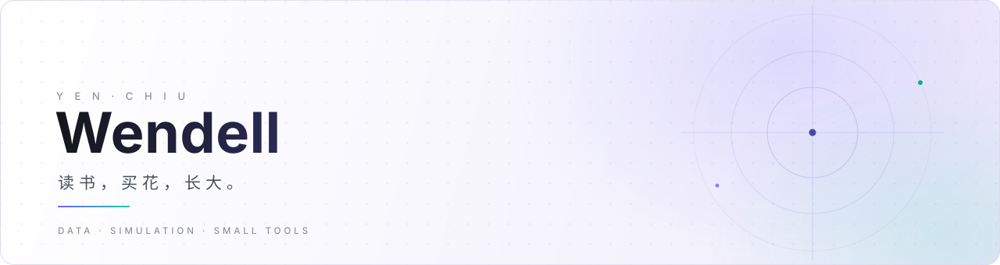

<picture>
  <source media="(prefers-color-scheme: dark)" srcset="assets/images/hero-dark.svg" />
  <source media="(prefers-color-scheme: light)" srcset="assets/images/hero-light.svg" />
  
</picture>

 

[博客](https://yenchiu.com) &nbsp;·&nbsp; [X](https://x.com/Xiao_Bard) &nbsp;·&nbsp; [邮件](mailto:yenchiu.he@gmail.com) &nbsp;·&nbsp; [WakaTime](https://wakatime.com/@yen-chiu)

## 关于

嗨，我是 **Wendell**。业余时间写点代码，也爱摄影、读书与旅行。

平时主要用 **Python / R / MATLAB** 做数据分析与建模仿真，也折腾 **Linux、博客和自动化小工具**。相信「记录本身就是一种整理」，于是有了这个长期维护的[个人博客](https://yenchiu.com)。

## 现在

- 给博客做减法，维护写作台和几件自动化小工具
- 把两个老游戏搬进自己的小站——[异次元通讯](https://yenchiu.com/chat/play.html?a=miko) 与 [生命线](https://yenchiu.com/chat/play.html?a=lifeline)，收进同一个手机抽屉
- 现居长沙

## 做的东西

**[yenchiu.com](https://yenchiu.com)** — 个人博客：技术笔记、读书与生活。 Jekyll · Chirpy · GitHub Pages

**[Chat](https://github.com/yen-chiu/Chat)** — 「与念真聊天中」，一个可以聊天的个人小站，也放着上面那两个网页版游戏。 HTML · CSS · JavaScript

**[WendellManual](https://github.com/yen-chiu/WendellManual)** — 博客的使用说明与文档站。 Jekyll · Just the Docs

**[math-model](https://github.com/yen-chiu/math-model)** — Python 数学实验与建模的课件、程序与习题。 Python · Jupyter

## 写作

<!-- BLOG-POST-LIST:START -->
- [把《异次元通讯·次元复苏》搬进浏览器](https://yenchiu.com/posts/miko-web/)
- [给 AI 装一双逆向之眼：REA 接入 DeepSeek Harness](https://yenchiu.com/posts/dsh-rea-install/)
- [念真怎么上网：纯静态站的搜索与读页架构](https://yenchiu.com/posts/nianzhen-web-architecture/)
- [「科学修仙时代」：把修仙拍成村口吵架](https://yenchiu.com/posts/ai%E5%8A%A8%E7%94%BB/)
- [刷新一下](https://yenchiu.com/posts/refresh-button/)
<!-- BLOG-POST-LIST:END -->

## GitHub

  <picture>
    <source media="(prefers-color-scheme: dark)" srcset="https://raw.githubusercontent.com/yen-chiu/yen-chiu/output/github-contribution-grid-snake-dark.svg" />
    <source media="(prefers-color-scheme: light)" srcset="https://raw.githubusercontent.com/yen-chiu/yen-chiu/output/github-contribution-grid-snake.svg" />
    
  </picture>

  <picture>
    <source media="(prefers-color-scheme: dark)" srcset="https://github-readme-streak-stats.herokuapp.com/?user=yen-chiu&theme=dark&hide_border=true&background=0D1117&ring=6366F1&fire=EC4899&stroke=A78BFA" />
    <source media="(prefers-color-scheme: light)" srcset="https://github-readme-streak-stats.herokuapp.com/?user=yen-chiu&theme=default&hide_border=true&ring=6366F1&fire=EC4899" />
    
  </picture>

常用工具与数据

 

  

  
  
  
  
  

  
  
  
  

   
  
  读书，买花，长大。 · 用 <a href="https://jekyllrb.com">Jekyll</a> + <a href="https://github.com/cotes2020/jekyll-theme-chirpy">Chirpy</a> 搭建

<!-- 资源 -->
<!-- 头图：自制 SVG，assets/images/hero-light.svg / hero-dark.svg -->
<!-- 图标：https://simpleicons.org/ -->
<!-- 徽章：https://shields.io/ -->
<!-- 贪吃蛇：https://github.com/Platane/snk （.github/workflows/snake.yml 每天自动更新） -->
<!-- 连续贡献：https://github.com/DenverCoder1/github-readme-streak-stats -->
<!-- Emoji：https://emojipedia.org/ -->
