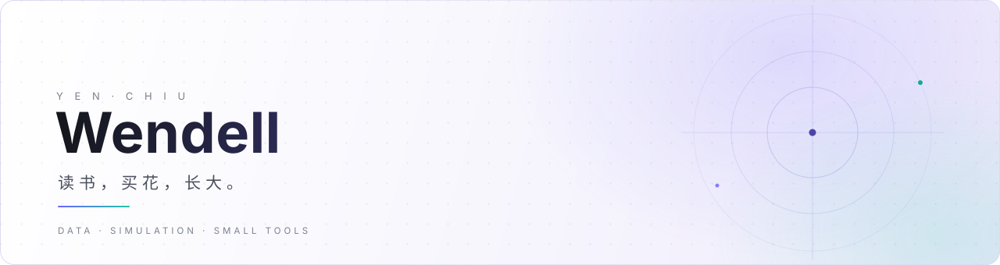
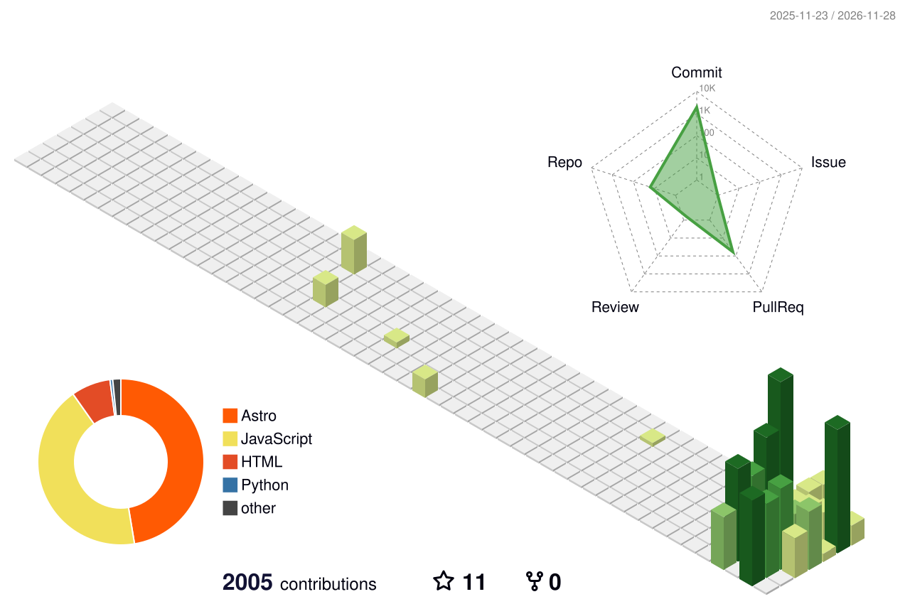

<picture>
  <source media="(prefers-color-scheme: dark)" srcset="assets/images/hero-dark.svg" />
  <source media="(prefers-color-scheme: light)" srcset="assets/images/hero-light.svg" />
  
</picture>

  

  

[博客](https://yenchiu.com) &nbsp;·&nbsp; [邮件](mailto:yenchiu.he@gmail.com) &nbsp;·&nbsp; [仓库](https://github.com/yen-chiu?tab=repositories)

  

## 关于

嗨，我是 **Wendell**。业余时间写点代码，也爱摄影、读书与旅行。

平时主要用 **Python / R / MATLAB** 做数据分析与建模仿真，也折腾 **Linux、博客和自动化小工具**。相信「记录本身就是一种整理」，于是有了这个长期维护的[个人博客](https://yenchiu.com)。

## 现在

- 维护 Vesper 博客、Folio 文档库和 Echora 聊天空间，记录代码、阅读与生活
- 把两个老游戏搬进自己的小站——[异次元通讯](https://yenchiu.com/echora/play.html?a=miko) 与 [生命线](https://yenchiu.com/echora/play.html?a=lifeline)，收进同一个手机抽屉
- 现居长沙

## 做的东西

**[Vesper · yenchiu.com](https://yenchiu.com)** — 个人网站与博客：技术实践、阅读笔记和生活片段。 Astro · Vesper · GitHub Pages

**[Echora](https://yenchiu.com/echora/)** — 与念真聊天，也收藏互动故事和两个网页版老游戏。 [源码](https://github.com/yen-chiu/echora) HTML · CSS · JavaScript

**[Folio](https://yenchiu.com/folio/)** — 建站笔记、工具备忘与知识整理，从 WendellManual 迁移而来。 [源码](https://github.com/yen-chiu/folio) Astro · Starlight

**[《余白》](https://yenchiu.com/journal/)** — 为散文、随笔和诗留一处安放之地。

**[math-model](https://github.com/yen-chiu/math-model)** — Python 数学实验与建模的课件、程序与习题。 Python · Jupyter

## 写作

<!-- BLOG-POST-LIST:START -->
- [Git 笔记：Squash Merge 与三种 PR 合并方式](https://yenchiu.com/blog/git-squash-merge)
- [Markdown 排版实验室：Vesper 显示效果测试](https://yenchiu.com/blog/markdown)
- [网址末尾那个斜杠，到底要不要？](https://yenchiu.com/blog/trailing-slash-301)
- [把《异次元通讯·次元复苏》搬进浏览器](https://yenchiu.com/blog/miko-web)
- [给 AI 装一双逆向之眼：REA 接入 DeepSeek Harness](https://yenchiu.com/blog/dsh-rea-install)
<!-- BLOG-POST-LIST:END -->

## GitHub

  <picture>
    <source media="(prefers-color-scheme: dark)" srcset="https://raw.githubusercontent.com/yen-chiu/yen-chiu/output/github-contribution-grid-snake-dark.svg" />
    <source media="(prefers-color-scheme: light)" srcset="https://raw.githubusercontent.com/yen-chiu/yen-chiu/output/github-contribution-grid-snake.svg" />
    
  </picture>

  <picture>
    <source media="(prefers-color-scheme: dark)" srcset="profile-3d-contrib/profile-night-green.svg" />
    <source media="(prefers-color-scheme: light)" srcset="profile-3d-contrib/profile-green-animate.svg" />
    
  </picture>

<table align="center" border="0">
  <tr>
    <td align="center">
      <picture>
        <source media="(prefers-color-scheme: dark)" srcset="https://github-readme-stats.vercel.app/api?username=yen-chiu&show_icons=true&hide_border=true&bg_color=00000000&title_color=A78BFA&icon_color=6366F1&text_color=C9D1D9&rank_icon=github" />
        <source media="(prefers-color-scheme: light)" srcset="https://github-readme-stats.vercel.app/api?username=yen-chiu&show_icons=true&hide_border=true&bg_color=FFFFFF00&title_color=6366F1&icon_color=6366F1&text_color=1F2328&rank_icon=github" />
        
      </picture>
    </td>
    <td align="center">
      <picture>
        <source media="(prefers-color-scheme: dark)" srcset="https://github-readme-stats.vercel.app/api/top-langs/?username=yen-chiu&layout=compact&langs_count=6&hide_border=true&bg_color=00000000&title_color=A78BFA&text_color=C9D1D9" />
        <source media="(prefers-color-scheme: light)" srcset="https://github-readme-stats.vercel.app/api/top-langs/?username=yen-chiu&layout=compact&langs_count=6&hide_border=true&bg_color=FFFFFF00&title_color=6366F1&text_color=1F2328" />
        
      </picture>
    </td>
  </tr>
</table>

  <picture>
    <source media="(prefers-color-scheme: dark)" srcset="https://github-readme-streak-stats.herokuapp.com/?user=yen-chiu&theme=dark&hide_border=true&background=0D1117&ring=6366F1&fire=EC4899&stroke=A78BFA" />
    <source media="(prefers-color-scheme: light)" srcset="https://github-readme-streak-stats.herokuapp.com/?user=yen-chiu&theme=default&hide_border=true&ring=6366F1&fire=EC4899" />
    
  </picture>

  <picture>
    <source media="(prefers-color-scheme: dark)" srcset="https://github-readme-activity-graph.vercel.app/graph?username=yen-chiu&bg_color=00000000&color=A78BFA&line=6366F1&point=EC4899&area=true&area_color=6366F1&hide_border=true" />
    <source media="(prefers-color-scheme: light)" srcset="https://github-readme-activity-graph.vercel.app/graph?username=yen-chiu&bg_color=00000000&color=1F2328&line=6366F1&point=EC4899&area=true&area_color=6366F1&hide_border=true" />
    
  </picture>

  

常用工具与数据

 

  

  
  
  
  
  

  
  
  
  

   
  
  读书，买花，长大。 · 博客使用 <a href="https://astro.build">Astro</a> + <a href="https://github.com/yen-chiu/yen-chiu.github.io">Vesper 暮星</a>

<!-- 资源 -->
<!-- 头图：自制 SVG，assets/images/hero-light.svg / hero-dark.svg -->
<!-- 图标：https://simpleicons.org/ -->
<!-- 徽章：https://shields.io/ -->
<!-- 贪吃蛇：https://github.com/Platane/snk （.github/workflows/snake.yml 每天自动更新） -->
<!-- 连续贡献：https://github.com/DenverCoder1/github-readme-streak-stats -->
<!-- 统计卡与常用语言：https://github.com/anuraghazra/github-readme-stats -->
<!-- 活动曲线：https://github.com/Ashutosh00710/github-readme-activity-graph -->
<!-- 打字机：https://github.com/DenverCoder1/readme-typing-svg -->
<!-- 访客数：https://github.com/antonkomarev/github-profile-views-counter -->
<!-- Emoji：https://emojipedia.org/ -->
